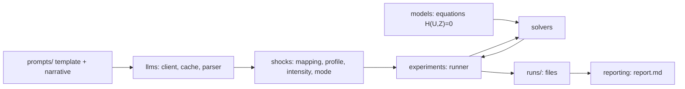
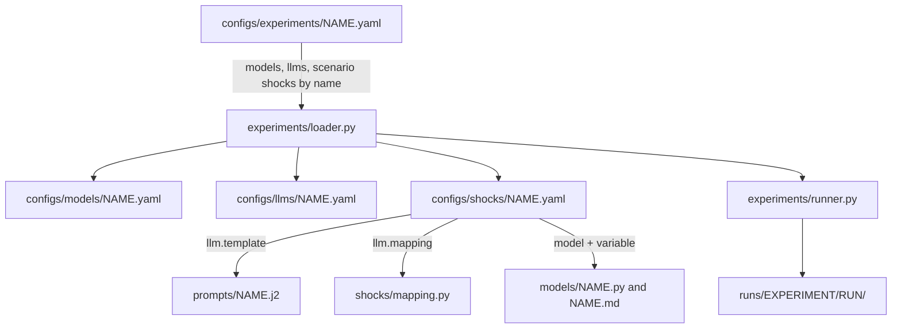

# LLMs as inputs to macro models

Experiments that use an LLM to modify one input of a standard macro model (RBC, NK, Krusell-Smith, later TANK/HANK)
instead of replacing the model: the LLM output becomes a path added to, or substituted for, an exogenous input
(for example the household taste shifter `d`), and the model's own equations do the rest.

Background: [literature review](claude_lit_review_LLMs_for_DGSE.md), [planning notes](notes%20from%20planning.md).

## Install and run (you run these)

1. `pip install -e ".[dev]"` (add `,openai` for the OpenAI provider).
2. `pytest` runs everything offline (the Krusell-Smith tests are marked `slow`); `pytest -m "not slow"` skips them.
3. `dgse-llm list`
4. `dgse-llm run configs/experiments/smoke_manual.yaml --report`
5. `dgse-llm run configs/experiments/ks_pandemic_mock.yaml --report`

For a real model: copy `secrets/secrets.example.env` to `secrets/secrets.env`, fill in the key, then run
`configs/experiments/ks_pandemic_openai.yaml`. Live tests: `pytest --run-live`.

## Layout

| Folder | Contents | README |
| --- | --- | --- |
| `src/dgse_llm/schemas` | Pydantic input and output records | [schemas](src/dgse_llm/schemas/README.md) |
| `src/dgse_llm/models` | One `.py` and one `.md` per macro model | [models](src/dgse_llm/models/README.md) |
| `src/dgse_llm/solvers` | Pluggable solvers, independent of models | [solvers](src/dgse_llm/solvers/README.md) |
| `src/dgse_llm/llms` | LLM clients, cache, parser, secrets | [llms](src/dgse_llm/llms/README.md) |
| `src/dgse_llm/shocks` | Profiles, mappings, injection | [shocks](src/dgse_llm/shocks/README.md) |
| `src/dgse_llm/experiments` | Grid expansion, runner, storage, metrics | [experiments](src/dgse_llm/experiments/README.md) |
| `src/dgse_llm/reporting` | Markdown reports | [reporting](src/dgse_llm/reporting/README.md) |
| `configs/` | YAML for models, LLMs, shocks, experiments | [configs](configs/README.md) |
| `prompts/` | Jinja prompt templates | [prompts](prompts/README.md) |
| `secrets/` | Your API keys (gitignored) | [secrets](secrets/README.md) |
| `runs/` | Generated outputs (gitignored) | [runs](runs/README.md) |
| `tests/` | Tests mirroring `src` | [tests](tests/README.md) |

## How a config becomes a run (where everything is wired)

You only edit YAML files in `configs/` and templates in `prompts/`. Files refer to each other by file name (without
`.yaml`):

The shock config is the one place where a prompt is wired to a model variable. Example, `configs/shocks/ks_pandemic_d.yaml`:

| Step | Field in the shock config | Example | Defined in |
| --- | --- | --- | --- |
| Model and input that is modified | `model`, `variable`, `mode` | `krusell_smith`, `d`, `additive` | shockable inputs: `models/<model>.py` and `.md` |
| Prompt template | `llm.template` | `household_consumption.j2` | `prompts/` |
| Extra template variables | `llm.template_vars` (plus `narrative` and `t`, filled by the code) | `persona` | the template itself |
| Number(s) the LLM must answer | `llm.keys`, `llm.key` (the one that drives the shock) | `social_change_pct` | JSON keys named in the template |
| Plausible range of the raw answer | `llm.answer_bounds` | `[-100, 100]` | pydantic validation, `llms/parsing.py` |
| Conversion to model units | `llm.mapping`, `llm.mapping_params` | `linear`, slope -0.001 (so -40% gives `d` = +0.04) | `shocks/mapping.py` |
| Scale and timing | `intensity`, `profile`, `llm.events`, `llm.tail_decay` | 1.0, narrative timeline | `shocks/README.md` |

Which LLM answers is NOT in the shock config: the experiment's `llms:` list picks it, so one shock config runs with any
LLM. A classic (no-LLM) shock replaces the `llm` block with `source: classic` and `classic: <name>` defined by the
model. See [shocks](src/dgse_llm/shocks/README.md) and [configs](configs/README.md).

After a run, check the wiring in the run folder: `config.resolved.yaml` (everything that was used), `manifest.json`
(`modified`: variable, mode, source of each shock), `llm_calls.jsonl` (rendered prompt, raw answer, parsed number,
errors) and `shock_paths.parquet` (the path that was injected into the variable).

## How to add things

| To add | Do |
| --- | --- |
| A macro model | Copy `models/_template.py` to `<name>.py`, write `<name>.md`, add `configs/models/<name>.yaml` |
| An LLM provider | Copy `llms/providers/_template.py`, add `configs/llms/<name>.yaml` and the key name to `secrets/secrets.example.env` |
| A solver | New file in `solvers/` with `@register_solver`; switch with `solver:` in the model config |
| A shock | New YAML in `configs/shocks/`; new time profile or mapping = one decorated function |
| An experiment | New YAML in `configs/experiments/` |

Switching to SSJ later changes only `solver:` plus an optional `to_ssj()` on a model; models, shocks and experiments are untouched.

## Not in v1

TANK and HANK models, unanticipated (sequential re-solve) shocks, and the decomposition of the LLM response into
model-implied and LLM-only parts. Outputs already hold baseline, shocked and IRF so these can be added without changing the layout.
