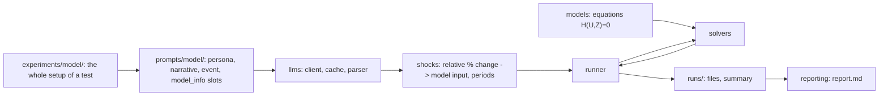
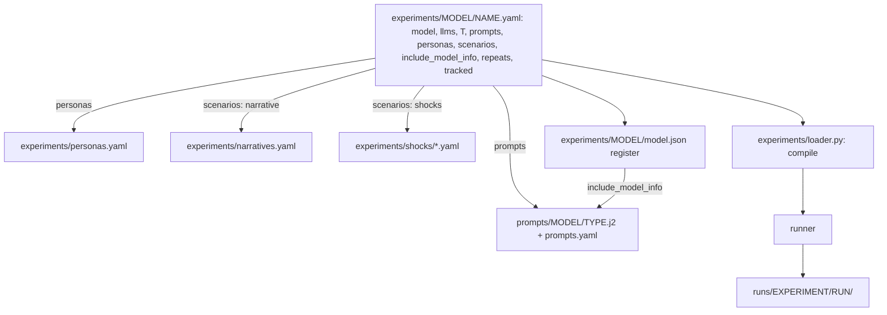

# LLMs as inputs to macro models

Experiments that use an LLM to modify one input of a standard macro model (RBC, NK, Krusell-Smith, later TANK/HANK)
instead of replacing the model: the LLM output becomes a path added to, or substituted for, an exogenous input
(for example the household taste shifter `d`), and the model's own equations do the rest.

Background: [literature review](claude_lit_review_LLMs_for_DGSE.md), [planning notes](notes%20from%20planning.md).



## Install and run (you run these)

1. `pip install -e ".[dev]"` (add `,openai` for the OpenAI provider).
2. `pytest` runs everything offline (the Krusell-Smith tests are marked `slow`); `pytest -m "not slow"` skips them.
3. `dgse-llm list` (models, shockable inputs, prompt types)
4. `dgse-llm run experiments/nk3/mock.yaml --report` (or the short form `dgse-llm run nk3/mock --report`)
5. `dgse-llm run experiments/rbc/mock.yaml --report`
6. `dgse-llm evaluate nk3_mock` (or add `--evaluate` to `run`): like-with-like comparisons in `runs/<id>/evaluations/`

For a real model: copy `secrets/secrets.example.env` to `secrets/secrets.env`, fill in the key, then run
`experiments/<model>/generic.yaml`. Live tests: `pytest --run-live`.

## Layout

| Folder | Contents | README |
| --- | --- | --- |
| `experiments/` | Everything about a test: per macro model a write-up, `model.json` register and experiment YAMLs (model, LLMs, scenarios, tracked variables); shared `personas.yaml`, `narratives.yaml` and `shocks/` | [experiments](experiments/README.md) |
| `prompts/` | One folder per macro model: one `.j2` per prompt type and `prompts.yaml` | [prompts](prompts/README.md) |
| `configs/` | `plotting.yaml` only: the system-wide plot style | [configs](configs/README.md) |
| `src/dgse_llm/schemas` | Pydantic input and output records | [schemas](src/dgse_llm/schemas/README.md) |
| `src/dgse_llm/models` | One `.py` and one `.md` per macro model | [models](src/dgse_llm/models/README.md) |
| `src/dgse_llm/solvers` | Pluggable solvers, independent of models | [solvers](src/dgse_llm/solvers/README.md) |
| `src/dgse_llm/llms` | LLM clients, cache, parser, secrets | [llms](src/dgse_llm/llms/README.md) |
| `src/dgse_llm/shocks` | Time profiles, conversions, injection | [shocks](src/dgse_llm/shocks/README.md) |
| `src/dgse_llm/experiments` | Spec compilation, register, runner, storage, summary | [experiments](src/dgse_llm/experiments/README.md) |
| `src/dgse_llm/reporting` | Markdown reports | [reporting](src/dgse_llm/reporting/README.md) |
| `src/dgse_llm/evaluation` | Like-with-like comparisons across LLMs, personas, scenarios, model info | [evaluation](src/dgse_llm/evaluation/README.md) |
| `secrets/` | Your API keys (gitignored) | [secrets](secrets/README.md) |
| `runs/` | Generated outputs (gitignored) | [runs](runs/README.md) |
| `tests/` | Tests mirroring `src` | [tests](tests/README.md) |

## How an experiment file becomes a run

You edit YAML in `experiments/<model>/` and prompts in `prompts/<model>/`. The run command only points at an experiment
file; the file holds the whole setup:



An experiment file (shortened):

```yaml
id: ks_generic
description: What this tests.
model: krusell_smith                  # or {name: krusell_smith, params: {nA: 500}}
llms:                                 # name -> settings; temperature null if the model takes none
  gpt4o_mini_t0: {provider: openai, model_id: gpt-4o-mini, temperature: 0.0, api_key_env: OPENAI_API_KEY}
  gpt4o_mini_t1: {provider: openai, model_id: gpt-4o-mini, temperature: 1.0, api_key_env: OPENAI_API_KEY}
T: 120
prompts: [tfp, discount_factor, household_consumption]   # prompts/krusell_smith/*.j2
personas: all                                             # or a subset: [normal, economist]
scenarios:                                                # optional narrative + named shocks (period -> event)
  pandemic_one_time: {shocks: {4: pandemic_rumours}}
  mixed: {narrative: recession, shocks: {5: energy_price_spike, 12: sovereign_default, 20: technology_breakthrough}}
include_model_info: [false, true]                         # with and without the model's name and parameters
repeats: 5                                                # only used when temperature != 0
tracked: [Z, d, beta, Y, C, K, r, w]
```

Runs = LLMs x prompts x personas x scenarios x `include_model_info` (x `repeats` where temperature is not 0).

| Step | Where it is defined |
| --- | --- |
| Which input is shocked, and is it shockable | `prompts/<model>/prompts.yaml` (`variable`), checked against `experiments/<model>/model.json` |
| What the LLM sees | `prompts/<model>/<type>.j2` with `persona`, `narrative` (optional context), `event`, `model_info`; `model_info` is built from `model.json` and the parameters used |
| What the LLM answers | always `{"change_pct": <number>}`, a relative percentage change (`prompts/_answer_format.j2`) |
| Plausible range of the answer | `answer_bounds` in `prompts.yaml` (pydantic) |
| Conversion to model units | `per_pct` in `prompts.yaml` for inputs with baseline 0; otherwise `baseline x change_pct / 100` |
| When the shock is active | the experiment's scenarios: `shocks: {5: A, 12: B, 20: C}` puts shock A in period 5, B in 12, C in 20; each shock (a file in `experiments/shocks/`) is just an event text, each event its own LLM call |
| Which LLM, temperature, key | the `llms` mapping of the experiment (temperature 0: one cached draw; otherwise `repeats` draws) |

After a run, check the wiring in the run folder: `config.resolved.yaml`, `manifest.json` (axes, raw `answer`),
`llm_calls.jsonl` (rendered prompt, raw answer, parsed number, errors) and `shock_paths.parquet` (the path injected).
Across runs: `index.parquet`, `summary.parquet` (answer distribution, mean peak responses) and `info_effect.parquet`
(answer with minus without model info).

## How to add things

| To add | Do |
| --- | --- |
| A macro model | Copy `models/_template.py` to `<name>.py`, write `<name>.md`, add a colour in `configs/plotting.yaml`, `experiments/<name>/` (`README.md`, `model.json`, `generic.yaml`, `mock.yaml`) and `prompts/<name>/` (`prompts.yaml` and one `.j2` per shockable input). Tests check the register and prompts against the code |
| An LLM provider | Copy `llms/providers/_template.py`, add the key name to `secrets/secrets.example.env`, then use it in an experiment's `llms:` entry |
| A solver | New file in `solvers/` with `@register_solver`; switch with `model: {name: ..., solver: ...}` in the experiment |
| A prompt type | `prompts/<model>/<type>.j2` plus an entry in `prompts/<model>/prompts.yaml` |
| A persona, narrative or shock | One line in `experiments/personas.yaml` or `narratives.yaml`, or a new file in `experiments/shocks/` |
| An experiment | New YAML in `experiments/<model>/` (copy `generic.yaml`) |

Switching to SSJ later changes only `solver:` plus an optional `to_ssj()` on a model; models, prompts and experiments are untouched.

## Not in v1

TANK and HANK models, unanticipated (sequential re-solve) shocks, the decomposition of the LLM response into
model-implied and LLM-only parts, and shocks that reach only some households in Krusell-Smith (the `d` path applies to
all). Outputs already hold baseline, shocked and IRF so these can be added without changing the layout.
